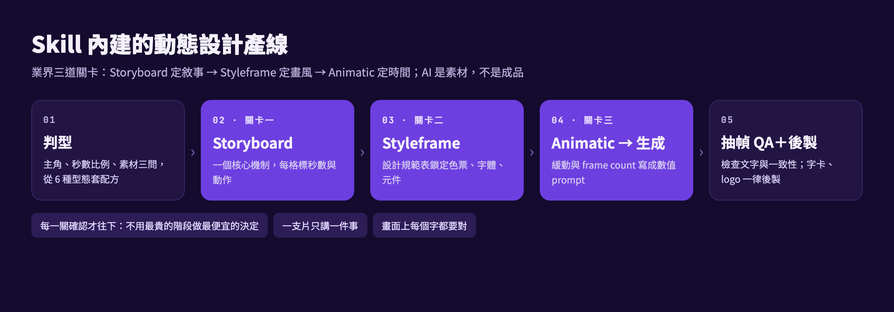

# Motion Design Skill

> 騰雲集團 2026 AI 應用競賽 · 作品 03
> 把動態設計（motion graphics）的專業流程打包成一個 Claude Code Skill，同事安裝後說一句需求，就能照同一套流程做出可以交給客戶的動態影片。



## 要解決的問題

- 外包一支 15 秒動態片要 3–5 週，費用高。
- 直接叫 AI 生影片：畫風飄、文字亂碼、logo 錯、鏡頭亂飛，做出「漂亮但不能交」的片，白白浪費生成點數。
- 分鏡、styleframe、緩動節奏、prompt 寫法、QA 修片這些方法只在個人腦中，同事每次重新踩坑。

## 這個 Skill 做什麼

Claude 載入 skill 後，會照業界的三道關卡帶著做，而不是一句 prompt 直接生成：

| 步驟 | 內容 | 參考檔 |
|---|---|---|
| 1. 判型 | 問三句（主角、秒數比例、素材），判定 6 種可賣型態之一並套配方 | `SKILL.md` |
| 2. Storyboard | 先定一個核心機制，每格標秒數與動作 | `references/styleframe-and-boards.md`、`assets/board-template.html` |
| 3. Styleframe | 產出設計規範表：色票、字體、元件庫，畫風在動之前定案 | `assets/design-sheet-template.html` |
| 4. Animatic → 生成 | 緩動、frame count、鏡頭語言寫成數值 prompt，再生成影片 | `references/craft-laws.md`、`prompt-blocks.md`、`camera-language.md` |
| 5. 抽幀 QA＋後製 | 檢查文字、角色一致、多餘物件；字卡與 logo 一律後製 | `references/text-integrity.md`、`overlay-repair.md` |

六種型態：SaaS／科技上市片、實拍＋動態字卡、Hyper-Motion 產品片、3D 建築／房地產動畫、2D Explainer 說明動畫、編輯式資訊圖表片（配方在 `references/recipes-2d.md`、`recipes-3d.md`，報價與修改輪次在 `references/business.md`）。

## 安裝

```bash
git clone <此 repo>
cd motion-design-skill
bash install.sh        # 複製到 ~/.claude/skills/motion-design（已有舊版會先備份）
```

或手動把 `skill/motion-design/` 整個資料夾複製到 `~/.claude/skills/`。

## 使用

在 Claude Code 裡直接說需求即可，例如：

- 「幫我做一支 15 秒的 SaaS 上市影片，產品網址是 …」
- 「把這張建築渲染圖做成 10 秒飛越動畫」
- 「做一支 30 秒 2D explainer，說明我們的活動報名流程」

Claude 會先判型、問清楚素材，再依序交出 storyboard → styleframe → animatic → 成片，每一關確認後才往下。

## 需求

| 項目 | 用途 | 必要性 |
|---|---|---|
| Claude Code | 執行 skill | 必要 |
| 影像生成 MCP（如 Banaverse） | 分鏡、styleframe 生圖；影片生成（MiniMax H3／Veo 等） | 必要 |
| ffmpeg | animatic、抽幀 QA、合成 | 必要 |
| Python 3＋Pillow | 字卡與 logo 後製 | 必要 |
| Google Chrome | 把 HTML 設計規範表截成圖 | 建議 |
| Noto Sans TC 字型 | 中文字卡 | 建議 |
| 作品 02 剪輯工具鏈的 TTS | 粗配旁白量時長（可用任何 TTS 取代） | 選用 |

環境事實（模型規格、費用、排隊時間）記錄於 2026-09，實際以各平台當下為準。

## 已用此 Skill 交付的作品

The Pocket Company 15 秒 2D 上市片、議網情生（青年網路治理）30 秒宣傳動畫。成品屬客戶所有，未放入此 repo。

## 結構

```
skill/motion-design/
├── SKILL.md            主流程、環境事實、六種型態、三道關卡
├── references/         11 份方法知識（緩動、鏡頭、文字、配方、報價…）
└── assets/             storyboard 與設計規範表 HTML 模板、文字安全區量測
install.sh              安裝到 ~/.claude/skills/
docs/pipeline.png       流程圖
```
